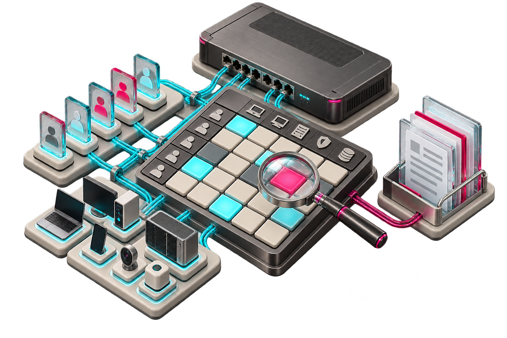

# Concept illustrations

These are conceptual portfolio illustrations. They are not screenshots, test evidence, a Cisco ISE integration or an implemented graphical interface. The product is an offline CLI that audits a declared normalized model.

