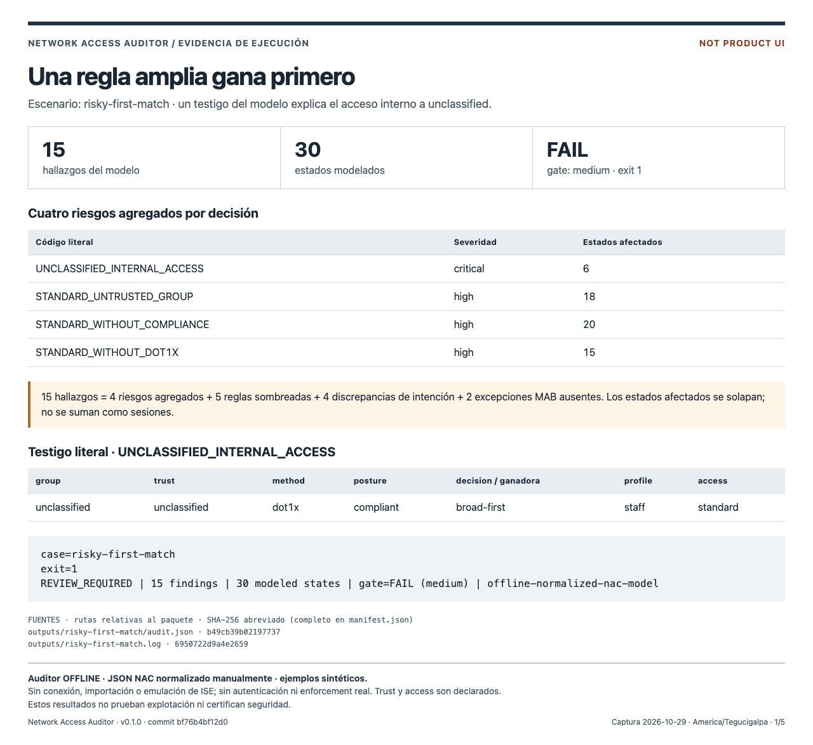
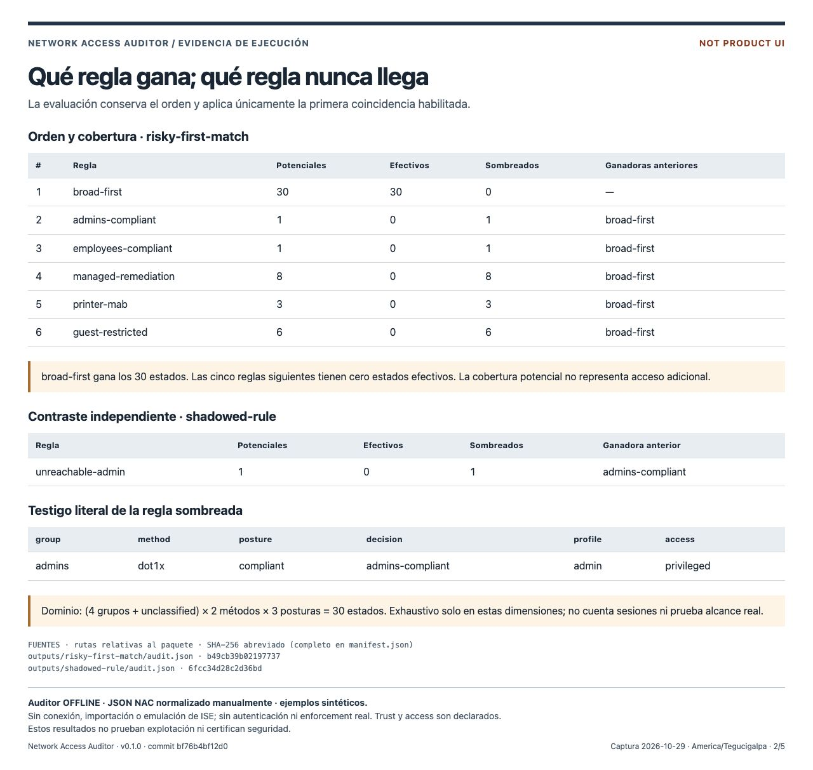
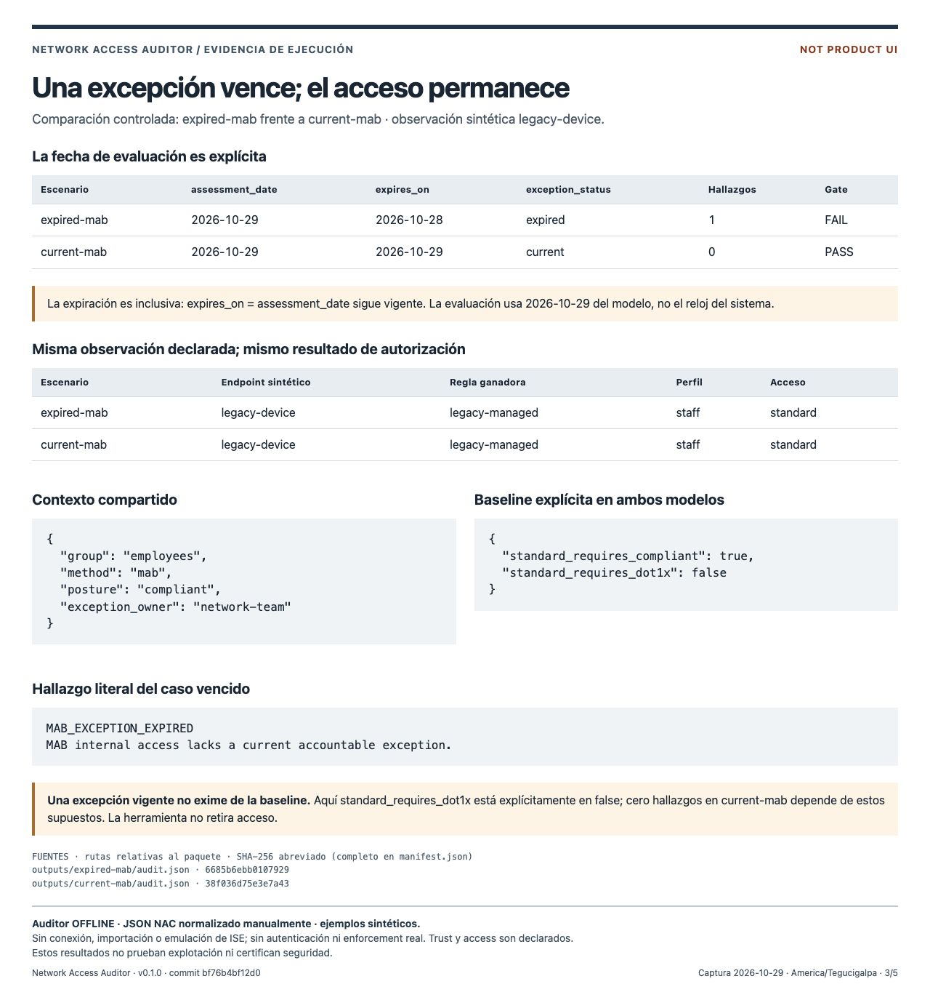
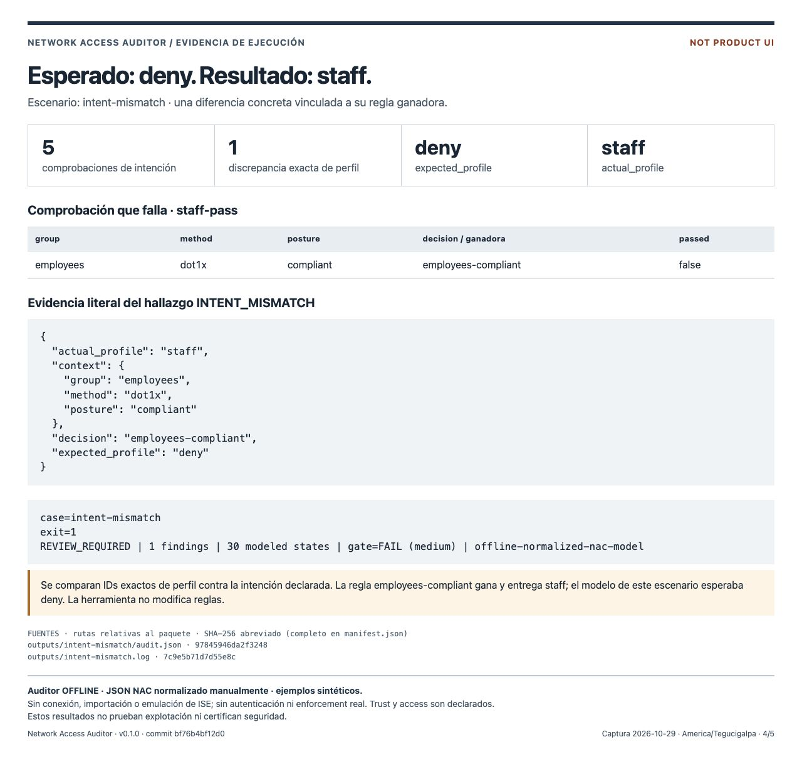
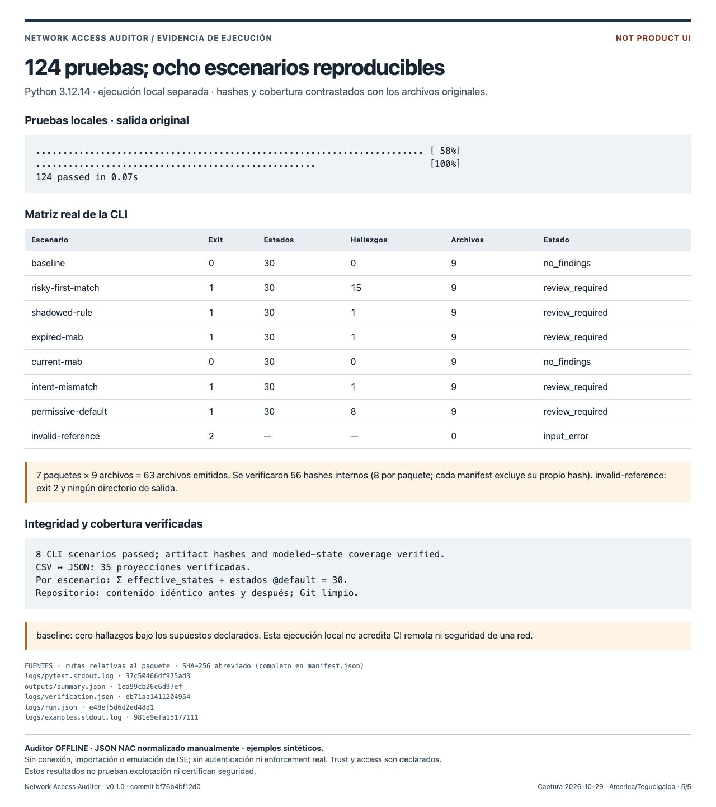

# Network Access Auditor — evidencia de ejecución

Paquete cerrado de **v0.1.0**, commit **bf76b4bf12d0c08422ed98ca05e024d9557f737b**. Capturas del **2026-10-29**, America/Tegucigalpa. Ejecución propia con **Python 3.12.14** y la CLI instalada en `.venv`.

Contiene cinco capturas originales JPEG de navegador, ocho inputs públicos sintéticos, siete paquetes de salida completos, registros originales y un visor HTML estático reproducible. El visor está rotulado **Not product UI**. Es una presentación de evidencia, no una interfaz del producto ni de Cisco ISE. No se retocaron, compusieron o redibujaron las imágenes. JPEG es el formato nativo devuelto por la API del navegador.

## Selección para integración

| Archivo | Contenido | Uso sugerido |
| --- | --- | --- |
| `images/01-risk-witness.jpg` | 15 hallazgos, cuatro riesgos agregados y un testigo de acceso unclassified | **Portafolio 1** |
| `images/02-rule-coverage.jpg` | Cobertura completa de risky-first-match y contraste con unreachable-admin | Documentación técnica |
| `images/03-mab-expiration.jpg` | Excepción vencida frente a vigente, fecha inclusiva y baseline explícita | **Portafolio 2** |
| `images/04-intent-mismatch.jpg` | expected deny, actual staff y regla employees-compliant | Documentación técnica |
| `images/05-verification.jpg` | 124 pruebas, ocho escenarios y verificación de hashes/cobertura | Verificación |

Los textos ES/EN y alt text están en `captions.md`. Conservar visibles las advertencias del pie al integrar las imágenes; no presentar el visor como interfaz del producto.

## Galería

### Riesgo y regla responsable



La regla amplia gana primero. Se muestran cuatro riesgos agregados, sus recuentos y un testigo literal. Los estados afectados pueden solaparse.

### Cobertura de las reglas



La tabla distingue condiciones coincidentes de resultados efectivos, e identifica la regla anterior que gana.

### Excepción MAB vencida



La fecha de evaluación viene del modelo. Una excepción vigente no exime de otros controles; la herramienta informa, no revoca acceso.

### Intención y resultado



La comparación usa identificadores exactos de perfil y conserva el contexto que produce la diferencia.

### Pruebas reproducibles



Ejecución local independiente. [Registro adicional de CI](../verification.md) en tres versiones de Python. Todos los visores son evidencia estática, no interfaz del producto.

## Resultados comprobados

- **124 pruebas pasaron**; exit 0. El tiempo 0.07 s corresponde únicamente a esta ejecución.
- **8 escenarios pasaron**. Siete producen nueve archivos cada uno; `invalid-reference` devuelve exit 2 y no crea directorio de salida.
- `risky-first-match`: **15 hallazgos = 4 riesgos agregados + 5 reglas sombreadas + 4 discrepancias de intención + 2 excepciones MAB ausentes**. Los recuentos de estados afectados se solapan.
- `expired-mab`: 1 hallazgo. `current-mab`: 0. Assessment 2026-10-29; expiración inclusiva hasta `expires_on`. Ambos declaran `standard_requires_dot1x: false` y `standard_requires_compliant: true`.
- `baseline`: ningún hallazgo bajo sus supuestos. Esto no certifica seguridad.
- **30 estados por modelo aceptado**: (4 grupos + unclassified) × 2 métodos × 3 posturas. La suma de estados efectivos por regla y estados que usan el default coincide con 30.
- 56 hashes internos verificados, ocho por cada uno de los siete paquetes. Sus manifests no se incluyen a sí mismos. Además, se contrastaron 35 proyecciones CSV con sus JSON.
- Los inputs copiados coinciden byte a byte con los usados por la CLI y sus hashes. Se verificó que todos los archivos del checkout, salvo metadatos `.git`, conservaban su contenido antes y después. Git estaba limpio. Los hashes de archivos versionados están en `logs/run.json`.

## Alcance e interpretación

Auditor **offline** de un modelo NAC JSON normalizado manualmente, con ejemplos sintéticos. No conecta con ISE, no importa exports nativos, no emula su motor completo, no valida autenticaciones o certificados, no aplica enforcement ni prueba conectividad o explotación real. No accede a dispositivos ni modifica reglas de una red.

`trust` de cada grupo y `access` de cada perfil son declaraciones del modelo; no se interpretan ACLs ni se demuestra que un perfil restringido imponga restricciones. `dot1x` es un método declarado, no prueba de autenticación. La cobertura es exhaustiva únicamente en las dimensiones declaradas. Los endpoints son observaciones suministradas, no sesiones descubiertas.

Una excepción vigente **no exime de los controles de baseline**. La ausencia de hallazgos en current-mab depende de su baseline explícita. La herramienta identifica la excepción vencida pero no revoca el acceso. Estas capturas acreditan una ejecución local; no una ejecución remota de CI.

## Reproducir sin depender de este workspace

Se requiere un checkout limpio en el commit indicado, con `.venv/bin/python`, pytest y `.venv/bin/naa` ya instalados. La instalación se prepara por separado; este procedimiento no instala ni cambia el checkout. Estando dentro de este paquete:

```sh
NAA_PACKAGE="$PWD"
# Cambia este valor por la ubicación de tu checkout limpio:
NAA_REPO="/ruta/al/network-access-auditor"
NAA_RUN="$(mktemp -d)"
python3 -B "$NAA_PACKAGE/provenance/run_evidence.py" \
  --repo "$NAA_REPO" --destination "$NAA_RUN/execution"
```

El destino `execution` debe ser nuevo. El script fija PATH a la `.venv`, desactiva bytecode y cache de pytest y dirige los temporales a ese destino. Ejecuta desde el checkout:

```sh
.venv/bin/python -m pytest -q -p no:cacheprovider --basetemp <destino-nuevo>/runtime/pytest
.venv/bin/python scripts/check_examples.py --output <destino-nuevo>/outputs
```

La segunda línea usa `naa` de la `.venv` mediante PATH. Cada escenario ejecuta `naa audit --input examples/<escenario>.json --output <destino>/<escenario>`. Los exit 1 de escenarios con hallazgos son esperados, no fallos del runner. Los logs stdout/stderr se guardan sin alteración.

Para verificar integridad y regenerar el visor, trabaja en una copia nueva, conservando este paquete cerrado:

```sh
# Desde la raíz del paquete original:
shasum -a 256 -c SHA256SUMS
NAA_COPY="$(mktemp -d)"
cp -R . "$NAA_COPY/package"
chmod -R u+w "$NAA_COPY/package"
python3 -B "$NAA_COPY/package/provenance/build_viewer.py"
# Servidor opcional solo local; también puedes abrir los HTML directamente:
python3 -B -m http.server 8769 --bind 127.0.0.1 --directory "$NAA_COPY/package"
```

Abre `/viewer/01-risk-witness.html` y las otras cuatro páginas en el navegador local. `provenance/capture.js` documenta las llamadas de CUA para guardarlas, sin transformar sus bytes. Se usó un viewport original de 1280 × 720 y captura **fullPage**; las imágenes incluyen todo el pie. El aspecto y hash de una captura nueva pueden variar con navegador, sistema y fuentes. El visor usa solo fuentes del sistema, sin recursos externos.

## Trazabilidad y cierre

`provenance/page-sources.json` describe las selecciones y columnas mostradas. Las cifras se leen de audit JSON y logs; textos explicativos y etiquetas son editoriales. `provenance/build_viewer.py` valida hashes, cobertura y consistencia CSV/JSON antes de generar las páginas. Las fuentes originales completas permanecen en `sources/` y `outputs/`.

`manifest.json` registra versión, commit, fecha, método de captura, revisión visual, selección para portafolio, dimensiones y hashes completos, con todas las rutas relativas al paquete. Incluye el mapa de fuentes de cada captura. `SHA256SUMS` cubre todos los archivos, incluido el manifest, y excluye únicamente su propio archivo. Los manifests nativos de la CLI se conservaron intactos.

Las cinco imágenes se revisaron visualmente: títulos, valores, tablas, notas y pie completos; sin recorte horizontal, rutas personales, credenciales, MACs o datos de clientes. Los datos proceden exclusivamente de los ejemplos públicos sintéticos. Los hashes comprueban integridad de contenido; no son firmas ni autenticación.

Después de terminar las pruebas y capturas, una tarea de integración comenzó a editar `README.md` y a añadir `docs/verification.md` en el repositorio. No son cambios de esta tarea ni entradas de la ejecución capturada. `logs/source-state-final.json` registra esa distinción; fuente, tests, scripts y ejemplos siguen coincidiendo con el commit fijado. La afirmación de Git limpio en la captura 05 corresponde al inicio y final de la ejecución registrada en `logs/run.json`, antes de esa integración.

Esta copia de documentación añade la galería al paquete de captura original. Las imágenes, fuentes y logs conservan sus bytes originales; se actualizaron el hash del README, el manifiesto de integración y SHA256SUMS. El código probado no cambió al integrar la documentación.
